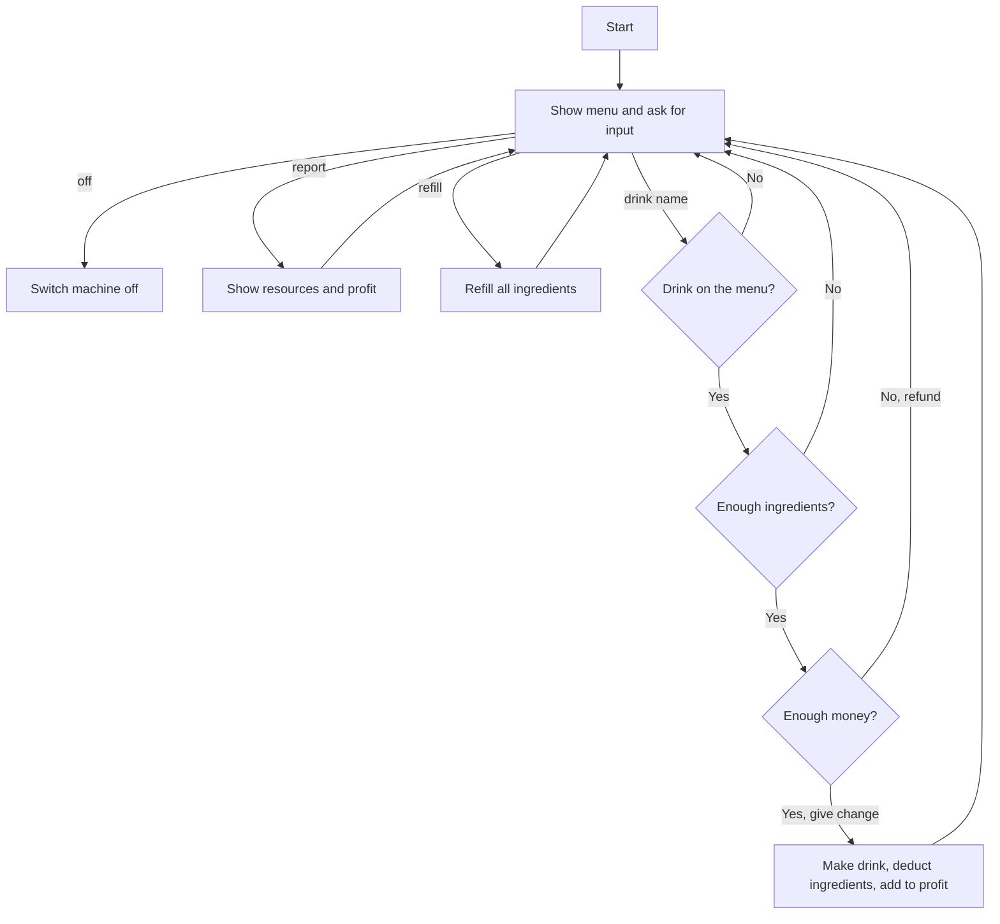

<a name="readme-top"></a>

# ☕ Coffee Machine Simulator


A command-line coffee machine simulator written in **Python** using **object-oriented programming (OOP)**. The user picks a drink, pays with coins, and the machine checks its ingredients, makes the drink and returns the correct change. The machine also keeps track of its remaining ingredients and total profit.

I built this project to practice OOP in Python: designing multiple classes, giving each a single responsibility, and making them work together.

---

## Table of Contents

- [Demo](#demo)
- [Features](#features)
- [How It Works](#how-it-works)
- [Project Structure](#project-structure)
- [Class Design](#class-design)
- [Getting Started](#getting-started)
- [Usage](#usage)
- [Menu and Machine Resources](#menu-and-machine-resources)
- [Sample Run](#sample-run)
- [Input Handling](#input-handling)
- [Concepts Demonstrated](#concepts-demonstrated)
- [Future Improvements](#future-improvements)
- [Author](#author)
- [License](#license)

---

## Demo


<p align="right">(<a href="#readme-top">back to top</a>)</p>

---

## Features

- Three drinks to choose from: **latte**, **espresso** and **cappuccino**
- Checks that the machine has enough **water, milk and coffee** before making a drink, and says which ingredient is missing
- Accepts payment in **coins** (quarters, dimes, nickels and pennies) and calculates the total
- Returns the exact **change**, or **refunds** the money if the payment is not enough
- Deducts the used ingredients after every successful order
- `report` command to see the remaining ingredients and total profit
- `refill` command to restore all ingredients to full levels
- `off` command to switch the machine off
- Handles unknown drink names and invalid coin input without crashing

<p align="right">(<a href="#readme-top">back to top</a>)</p>

---

## How It Works



<p align="right">(<a href="#readme-top">back to top</a>)</p>

---

## Project Structure

```
Coffe-app/
├── main.py            # Main loop that connects all the classes
├── menu.py            # Menu and MenuItem classes (drinks, ingredients, cost)
├── coffee_maker.py    # CoffeeMaker class (resource check, making coffee, report, refill)
├── money_machine.py   # MoneyMachine class (coin payment, change, profit)
├── LICENSE
└── README.md
```

<p align="right">(<a href="#readme-top">back to top</a>)</p>

---

## Class Design

| Class | File | Responsibility |
|---|---|---|
| `MenuItem` | `menu.py` | Stores one drink's name, cost and required ingredients |
| `Menu` | `menu.py` | Holds all drinks, lists their names and finds a drink by name |
| `CoffeeMaker` | `coffee_maker.py` | Tracks ingredient levels, checks if an order can be made, makes the drink, prints a report and refills |
| `MoneyMachine` | `money_machine.py` | Reads the coins, calculates the total, returns change or a refund and tracks profit |

`main.py` creates one object of `Menu`, `CoffeeMaker` and `MoneyMachine`, and runs the loop that passes the chosen `MenuItem` between them.

<p align="right">(<a href="#readme-top">back to top</a>)</p>

---

## Getting Started

### Prerequisites

- **Python 3.8 or higher.** The project was tested on Python 3.12 and is configured for 3.13.
- No external libraries are needed.

### Installation and Run

```bash
# 1. Clone the repository
git clone https://github.com/Anilkarande04/Coffe-app.git

# 2. Go into the project folder
cd Coffe-app

# 3. Start the machine
python main.py
```

<p align="right">(<a href="#readme-top">back to top</a>)</p>

---

## Usage

Type one of the commands below at the prompt and press Enter. Input is not case-sensitive.

| Input | What it does |
|---|---|
| `latte`, `espresso`, `cappuccino` | Orders that drink, then asks for coins |
| `report` | Shows the remaining water, milk, coffee and the total profit |
| `refill` | Refills water, milk and coffee to full levels |
| `off` | Turns the machine off |

When you order a drink, the machine asks how many quarters, dimes, nickels and pennies you are inserting.

<p align="right">(<a href="#readme-top">back to top</a>)</p>

---

## Menu and Machine Resources

| Drink | Water | Milk | Coffee | Price |
|---|---|---|---|---|
| Latte | 200 ml | 150 ml | 24 g | $2.50 |
| Espresso | 50 ml | 0 ml | 18 g | $1.50 |
| Cappuccino | 250 ml | 50 ml | 24 g | $3.00 |

**Full machine levels:** 300 ml water, 200 ml milk, 100 g coffee.

**Coin values:** quarter = $0.25, dime = $0.10, nickel = $0.05, penny = $0.01.

<p align="right">(<a href="#readme-top">back to top</a>)</p>

---

## Sample Run

```
What would you like ?(latte/espresso/cappuccino/)tea
Sorry that item is not available.
What would you like ?(latte/espresso/cappuccino/)latte
Please insert coins.
How many quarters?: 12
How many dimes?: 12
How many nickles?: 12
How many pennies?: 12
Here is $2.42 in change.
Here is your latte ☕️. Enjoy!
What would you like ?(latte/espresso/cappuccino/)latte
Sorry there is not enough water.
Sorry there is not enough milk.
What would you like ?(latte/espresso/cappuccino/)report
Water: 100ml
Milk: 50ml
Coffee: 76g
Money: $2.5
What would you like ?(latte/espresso/cappuccino/)refill
All ingredients have been refilled.
What would you like ?(latte/espresso/cappuccino/)off
```

<p align="right">(<a href="#readme-top">back to top</a>)</p>

---

## Input Handling

| Situation | What the machine does |
|---|---|
| Drink name is not on the menu | Prints "Sorry that item is not available." and shows the menu again |
| An ingredient is too low | Prints which ingredient is missing and does not ask for payment |
| Payment is less than the price | Prints "Sorry that's not enough money. Money refunded." |
| Coin count is not a whole number, or is negative | Asks again for that coin |
| Command is typed in capital letters or with extra spaces | Still works |

<p align="right">(<a href="#readme-top">back to top</a>)</p>

---

## Concepts Demonstrated

- **Classes and objects:** each part of the machine is its own class
- **Single responsibility:** menu, ingredients and money are handled by separate classes
- **Encapsulation:** each class keeps its own data (`resources`, `profit`, `ingredients`)
- **Object composition:** `main.py` passes a `MenuItem` object between `CoffeeMaker` and `MoneyMachine`
- **Class constants:** `FULL_TANK` in `CoffeeMaker`, `COIN_VALUES` and `CURRENCY` in `MoneyMachine`
- **Input validation:** `try/except` with a retry loop for coin input
- **Multi-file project structure** with imports between modules

<p align="right">(<a href="#readme-top">back to top</a>)</p>

---

## Future Improvements

- Save every sale to a CSV file and generate a sales report with Pandas
- Add automated unit tests for `CoffeeMaker` and `MoneyMachine`
- Add more drinks and let the menu be loaded from a file
- Build a simple graphical interface

<p align="right">(<a href="#readme-top">back to top</a>)</p>

---

## Author

**Anil Karande**
B.E. in Artificial Intelligence and Data Science

- LinkedIn: [linkedin.com/in/anil-karande](https://www.linkedin.com/in/anil-karande)
- Email: karandeanil84@gmail.com
- GitHub: [@Anilkarande04](https://github.com/Anilkarande04)

---

## License

Distributed under the MIT License. See the [LICENSE](LICENSE) file for details.

<p align="right">(<a href="#readme-top">back to top</a>)</p>
